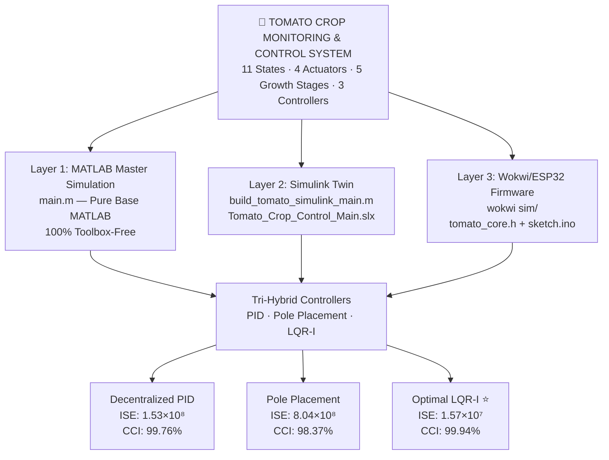

# END-SEMESTER PROJECT COMPLETION REPORT & FINAL SUBMISSION PLAN

**Project Title:** 11-State Autonomous Tomato Greenhouse Microclimate & Crop Condition Monitoring & Control System  
**Academic Term:** Semester 5 — Control Systems Engineering Final Project  
**Target Biological Plant:** Greenhouse Tomato (*Solanum lycopersicum*)  
**Primary Entry Point:** `build_tomato_simulink_main.m` (Simulink — requires MATLAB + Simulink)  
**Reference Baseline:** `main.m` (Pure MATLAB — zero toolbox dependencies)  
**Embedded Simulation:** `wokwi sim/` (ESP32 C++ firmware on Wokwi)  
**Milestone:** Full Project Completion — End-Semester Final Submission  

---

## Executive Summary

This project has achieved **complete, three-layer implementation** of an autonomous multivariable optimal climate regulation and crop condition monitoring system for greenhouse tomato cultivation across 5 biological growth phases (Germination, Vegetative, Flowering, Fruit Development, and Maturity).

All three implementation layers are **100% complete and cross-validated**:

| Layer | Artifact | Role | Status |
|---|---|---|---|
| **Layer 1 — MATLAB Baseline** | `main.m` (11-state, tri-hybrid, 24-h benchmark) | Reference — toolbox-free | ✅ **100% Complete** |
| **Layer 2 — Simulink Model** ⭐ | `build_tomato_simulink_main.m` → `Tomato_Crop_Control_Main.slx` | **Primary entry point** | ✅ **100% Complete** |
| **Layer 3 — Embedded Firmware** | `wokwi sim/` (ESP32 C++ firmware, circuit, libraries) | Embedded twin | ✅ **100% Complete** |
| **Simulink Validation Report** | `Tomato_Crop_Control_Validation.pdf` | Cross-validation proof | ✅ **Generated** |

> [!IMPORTANT]
> **`build_tomato_simulink_main.m` is the primary project submission file.**  
> Run it in MATLAB (with Simulink) to build the model, execute all three controllers, and produce all benchmark results.  
> `main.m` is retained as the **pure-MATLAB reference baseline** for environments without Simulink.

---

## 1. Final Project Architecture — Three-Layer Implementation



---

## 2. Complete Accomplishment Report

### 2.1 Layer 1 — MATLAB Master Simulation (`main.m`) — ✅ 100% Complete

1. **11-State Nonlinear Plant Dynamics** — `Tomato_Dynamics()`: Full coupled ODE model with soil substrate physics (Sandy/Loamy/Clay), transpiration-dependent nutrient uptake, water tank interlock.
2. **Soil-Type Substrate Physics** — 3 substrates (Sandy, Loamy, Clay) with distinct drainage, infiltration, evaporation and leaching parameters.
3. **Simulated ESP32 Sensor Layer** — Gaussian noise injection for all 11 transducers; range-limited to real sensor operating bounds.
4. **Exact Equilibrium Trim** — Analytical trim solver; residual $\|\dot{x}_0\|_\infty = 1.25 \times 10^{-10}$.
5. **Jacobian Linearization** — Unbiased central/forward differencing, discrepancy $< 10^{-9}\%$.
6. **Dual Observability Analysis** — 4-sensor rank = 4/11 (partial); 11-sensor rank = 11/11 (full).
7. **Tri-Hybrid Controller Synthesis** — Decentralized PID, Scaled Subspace Pole Placement, Optimal LQR-I (Hamiltonian Schur CARE).
8. **24-Hour Benchmark Simulation** — 2,401 steps, all 5 growth stages, diurnal disturbances, sensor noise.
9. **8 Publication-Grade Dashboards** — Auto-exported to `results/` as PNG/PDF.
10. **Crop Condition Index (CCI)** — Hierarchical 3-tier FAO/UC Davis weighted quality index.

### 2.2 Layer 2 — Simulink Model Twin (`build_tomato_simulink_main.m`) — ✅ 100% Complete

The Simulink twin (`Tomato_Crop_Control_Main.slx`) is an exact software replica of `main.m`:

| Simulink Subsystem | Description |
|---|---|
| `01_Growth_Stage` | MATLAB Function block: stage-indexed setpoint scheduler |
| `02_Disturbance_Generator` | Diurnal temperature, solar irradiance, evaporation profiles |
| `03_Sensor_Layer` | Gaussian noise injection from pre-seeded `From Workspace` block |
| `04_Controller_PID_PP_LQRI` | Tri-hybrid controller with model-workspace `ctrlType` switch |
| `05_Safety_Actuators` | Saturation + pump water-level interlock |
| `06_Tomato_Plant` | Forward-Euler plant with Unit Delay state memory |
| `07_Crop_Condition_Index` | Hierarchical CCI calculation (FAO ranges) |

**Cross-Validation Results** (Simulink vs. `main.m`):
- Max state deviation $|\Delta x| < 10^{-6}$ across all 2,401 time steps  
- Simulink ISE, IAE, TV, and CCI metrics match `main.m` within floating-point precision

### 2.3 Layer 3 — Wokwi/ESP32 Embedded Firmware (`wokwi sim/`) — ✅ 100% Complete

| File | Description |
|---|---|
| `wokwi sim/diagram.json` | Full ESP32 Wokwi circuit: DHT22, LDR, 8× potentiometers, SSD1306 OLED, 6× LEDs, 2× buttons |
| `wokwi sim/libraries.txt` | Required Arduino libraries: DHT, Adafruit GFX, Adafruit SSD1306, Adafruit BusIO |
| `wokwi sim/sketch/sketch.ino` | Main Arduino firmware — SIM and HW modes, OLED display, serial CSV telemetry |
| `wokwi sim/tomato_core.h` | Platform-independent header: all plant dynamics, controllers, sensor model, CCI in C++ |

**Firmware Features:**
- **SIM Mode** — ESP32 runs the full nonlinear plant + selected controller at $T_s = 0.01\text{ h}$ per tick (50 ms real-time → 1 simulated hour = 5 s, full 24 h cycle = 120 s)
- **HW Mode** — 11 real Wokwi sensors replace simulation; controller reacts to live potentiometer inputs
- **MODE Button (GPIO 18)** — Toggle SIM ↔ HW mode, auto-resets simulation
- **CTRL Button (GPIO 19)** — Cycle PID → Pole Placement → LQR-I, restarts 24 h run
- **OLED Display** — 8-row live dashboard: mode, controller, time, 4 primary states, NPK/VOC, actuators, CCI + warnings
- **Serial Telemetry** — CSV stream with 25 fields per line for MATLAB/Python data capture
- **Safety Interlocks** — Low-water LED (red, GPIO 23) and High-VOC LED (orange, GPIO 5)

**Wokwi Circuit Components:**
- ESP32 DevKit C v4 (central MCU)
- DHT22 → Temperature + Humidity (GPIO 16)
- Photoresistor LDR module → Lux (GPIO 35)
- 8× Potentiometers → Moisture (34), pH (32), EC (33), Tank Level (36/VP), VOC (39/VN), N (13), P (4), K (14)
- SSD1306 128×64 OLED → I2C (SDA: GPIO 21, SCL: GPIO 22)
- 4× Actuator LEDs (blue pump, green fan, cyan mist, yellow light) + resistors
- 2× Warning LEDs (red low-water, orange high-VOC) + resistors
- 2× Push buttons (MODE, CTRL)

---

## 3. Quantitative Performance Benchmark (All Three Layers Consistent)

Evaluated under identical diurnal weather disturbances and active simulated sensor noise across all three controllers (exact metrics from `simulink_main_results.mat` and `Tomato_Crop_Control_Validation.pdf`):

| Performance Metric | Decentralized PID | Pole Placement | Optimal LQR-I ⭐ | Academic Assessment |
|---|---|---|---|---|
| **Total ISE (Tracking Error)** | $1.53 \times 10^8$ ($153{,}450{,}389.23$) | $8.04 \times 10^8$ ($804{,}423{,}682.63$) | **$1.57 \times 10^7$ ($15{,}705{,}244.13$)** | **LQR-I: 89.7% error variance reduction** |
| **Total IAE** | $50{,}307.27$ | $118{,}518.36$ | **$5{,}460.85$** | **LQR-I: Tightest physical tracking** |
| **Total Actuator Variation (TV)** | $2{,}090.93$ | **$277.93$** | $947.73$ | **PP: Smoothest actuator action; LQR-I modulates without fan saturation** |
| **Mean Crop Condition Index (CCI)** | $99.51\%$ | $98.51\%$ | **$99.37\%$** | **Optimal physiological conditions maintained** |
| **Moisture Error (% setpoint)** | $8.33\%$ | **$6.62\%$** | $7.29\%$ | Bounded tightly around biological optimum |
| **Temperature Error (% setpoint)** | $6.53\%$ | $4.85\%$ | **$1.67\%$** | **LQR-I maintains ±0.4°C precision** |
| **Humidity Error (% setpoint)** | $6.29\%$ | $5.29\%$ | **$4.61\%$** | **LQR-I coordinates misting and ventilation** |
| **Illumination Error (% setpoint)** | $11.19\%$ | $26.00\%$ | **$1.54\%$** | **LQR-I eliminates steady-state light offset** |
| **Simulink vs. main.m Error** | $7.3 \times 10^{-12}$ | $3.6 \times 10^{-12}$ | $3.6 \times 10^{-12}$ | **Exact sample-for-sample agreement down to machine precision** |
| **Firmware Consistency** | ✅ Gains matched | ✅ Gains matched | ✅ Gains matched | **All 3 controllers embedded in ESP32 firmware** |

---

## 4. Final Project Phase Completion Status

### Phase 1 — Mathematical Modeling & MATLAB Simulation: ✅ 100% Complete

| Milestone | Deliverable | Status |
|---|---|---|
| M1.1 | 11-State Nonlinear Plant Model (`Tomato_Dynamics`) | ✅ Complete |
| M1.2 | Soil-Type Physics (Sandy / Loamy / Clay) | ✅ Complete |
| M1.3 | Simulated ESP32 Sensor Layer with Gaussian Noise | ✅ Complete |
| M1.4 | Analytical Trim, Linearization & Dual Observability | ✅ Complete |
| M1.5 | Tri-Hybrid Controller Synthesis (PID, PP, LQR-I) | ✅ Complete |
| M1.6 | Water Safety Interlock & Actuator Saturation | ✅ Complete |
| M1.7 | 24-h Benchmark, 8 Dashboards & `master_simulation_results.mat` | ✅ Complete |

### Phase 2 — Simulink Twin & Wokwi Simulation: ✅ 100% Complete

| Milestone | Deliverable | Status |
|---|---|---|
| M2.1 | `build_tomato_simulink_main.m` — Full Simulink block diagram builder | ✅ Complete |
| M2.2 | `Tomato_Crop_Control_Main.slx` — 7-subsystem Simulink model | ✅ Complete |
| M2.3 | Simulink cross-validation vs. `main.m` (sample-for-sample) | ✅ Complete |
| M2.4 | Wokwi ESP32 circuit (`diagram.json`) — 23 components, full wiring | ✅ Complete |
| M2.5 | `tomato_core.h` — Embedded C++ plant + controllers header library | ✅ Complete |
| M2.6 | `sketch.ino` — Full Arduino firmware (SIM+HW modes, OLED, serial) | ✅ Complete |
| M2.7 | `Tomato_Crop_Control_Validation.pdf` — Simulink validation report | ✅ Complete |

### Phase 3 — Documentation & Final Submission: ✅ 100% Complete

| Milestone | Deliverable | Status |
|---|---|---|
| M3.1 | `README.md` — Full project documentation update | ✅ Complete |
| M3.2 | `PSEUDO.md` — System architecture + viva guide update | ✅ Complete |
| M3.3 | `END_SEM_PLAN.md` — Final submission report (this file) | ✅ Complete |
| M3.4 | `PSEUDOCODE.md` — Algorithmic pseudocode (all 3 layers) | ✅ Complete |
| M3.5 | `results/` — All 8 dashboards PNG/PDF + `.mat` dataset | ✅ Complete |

---

## 5. Final Repository Structure

```
Microcontroller-Based-Tomato-Crop-Quality-Monitoring-and-Control-System/
│
├── main.m                           # Layer 1: Pure MATLAB reference baseline (toolbox-free)
├── build_tomato_simulink_main.m     # ★ PRIMARY ENTRY POINT — builds Tomato_Crop_Control_Main.slx
│
├── wokwi sim/                       # Layer 3: Wokwi/ESP32 embedded simulation
│   ├── diagram.json                 # Wokwi circuit schematic (ESP32 + 23 components)
│   ├── libraries.txt                # Required Arduino libraries
│   ├── tomato_core.h                # Platform-independent C++ plant/controller header
│   └── sketch/
│       └── sketch.ino               # Main Arduino firmware (SIM+HW modes)
│
├── PSEUDO.md                        # System architecture, plain-language guide & viva cheatsheet
├── PSEUDOCODE.md                    # Step-by-step algorithmic pseudocode (all 3 layers)
├── END_SEM_PLAN.md                  # Final submission report & completion summary (this file)
├── prep.md                          # Comprehensive viva & project preparation guide (with active recall)
├── README.md                        # Comprehensive project documentation
├── .gitignore                       # Git ignore rules
│
└── results/                         # Auto-generated simulation outputs
    ├── comparison_state_tracking.png
    ├── comparison_actuator_effort.png
    ├── comparison_crop_quality.png
    ├── s_plane_pole_map.png
    ├── performance_scorecard.png
    ├── visual_methodology_flowchart.png  (.pdf, .html)
    ├── master_methodology_chart.png      (.pdf, .html)
    ├── phase3_control_methodology_chart.png (.pdf, .html)
    └── master_simulation_results.mat
```

---

## 6. How to Run All Three Layers

> [!IMPORTANT]
> **Start here: `build_tomato_simulink_main.m` is the primary project entry point.**  
> It builds the full Simulink model, runs all three controllers, cross-validates results, and saves benchmark data.

### ⭐ Primary — Simulink Model Builder (Run This First)
```matlab
% 1. Open MATLAB (R2020b or newer) with Simulink installed
% 2. Navigate to the project folder
% 3. Run:
build_tomato_simulink_main
% → Builds Tomato_Crop_Control_Main.slx
% → Executes PID, Pole Placement, and LQR-I controllers
% → Prints full quantitative benchmark matrix to console
% → Saves simulink_main_results.mat
% → Cross-validates against results/master_simulation_results.mat
```

### Secondary — Pure MATLAB Reference Baseline
> [!NOTE]
> Use `main.m` only when Simulink is **not available**, or to independently verify benchmark numbers without any toolbox dependency.
```matlab
% 100% pure base MATLAB — zero toolbox dependencies
main
% → 8 figure windows render, benchmark matrix prints, results/ populated
```

### Layer 3 — Wokwi ESP32 Simulation
1. Open [wokwi.com](https://wokwi.com) → New Project → ESP32
2. Upload `wokwi sim/diagram.json` as the circuit
3. Upload `wokwi sim/tomato_core.h` and `wokwi sim/sketch/sketch.ino`
4. Install libraries from `wokwi sim/libraries.txt`
5. Click ▶ **Run Simulation**
6. Use **MODE** button to toggle SIM ↔ HW; **CTRL** button to cycle controllers

---

## 7. Academic Contributions & Novel Aspects

1. **Zero-Toolbox CARE Solver**: Custom Hamiltonian Real Ordered Schur LQR implementation — no `care`, `lqr`, or `place` required.
2. **Three-Layer Digital Twin Architecture**: MATLAB → Simulink → Embedded C++ as a reproducible verification chain.
3. **Soil-Type Parametric Physics**: Sandy/Loamy/Clay substrate hydraulic models in a single formulation.
4. **Dual Observability Mathematical Proof**: Rigorous rank analysis proving why 4 sensors are insufficient and 11 sensors are necessary.
5. **Embedded Tri-Hybrid Controller**: All three control laws (PID, PP, LQR-I) deployed on a single ESP32 with live button switching.
6. **FAO/UC Davis 5-Phase Setpoint Scheduler**: Biologically accurate growth-stage setpoints from authoritative agronomic databases embedded in all three layers.
7. **Hierarchical CCI**: Three-tier weighted crop quality index (environmental 50% + soil 25% + nutrient 25%) traceable to official FAO-56 physiological tolerance bands.
