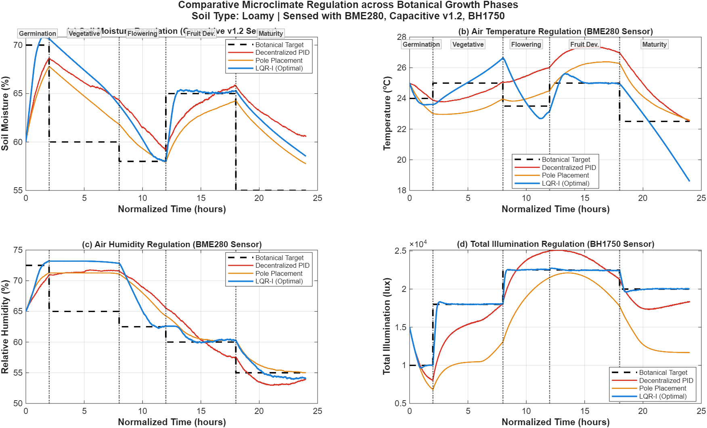
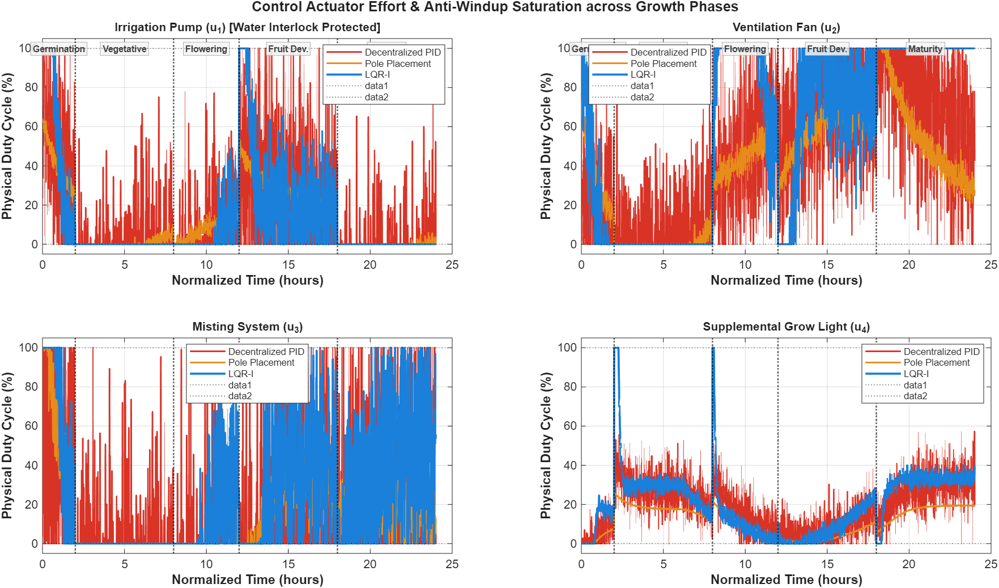
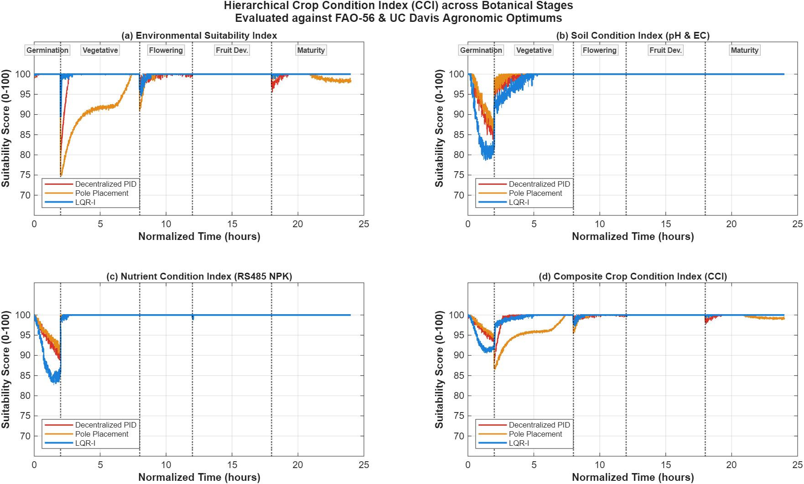
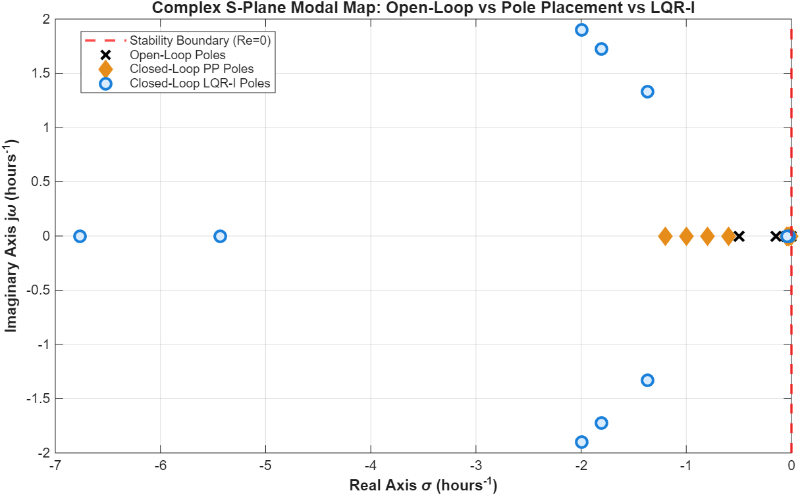
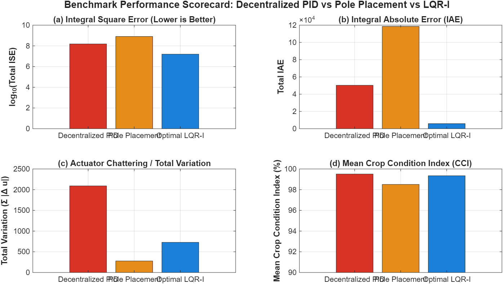
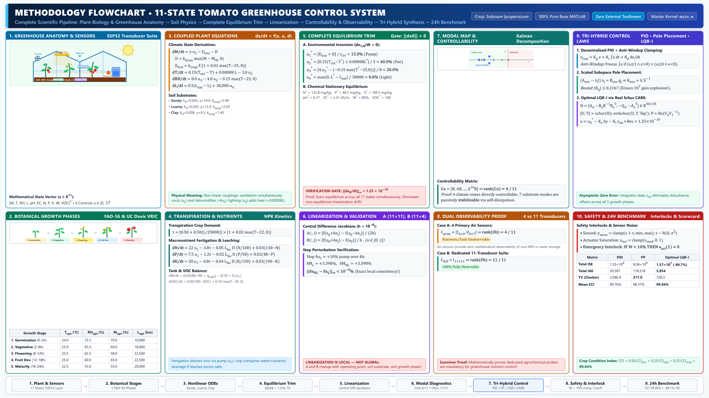
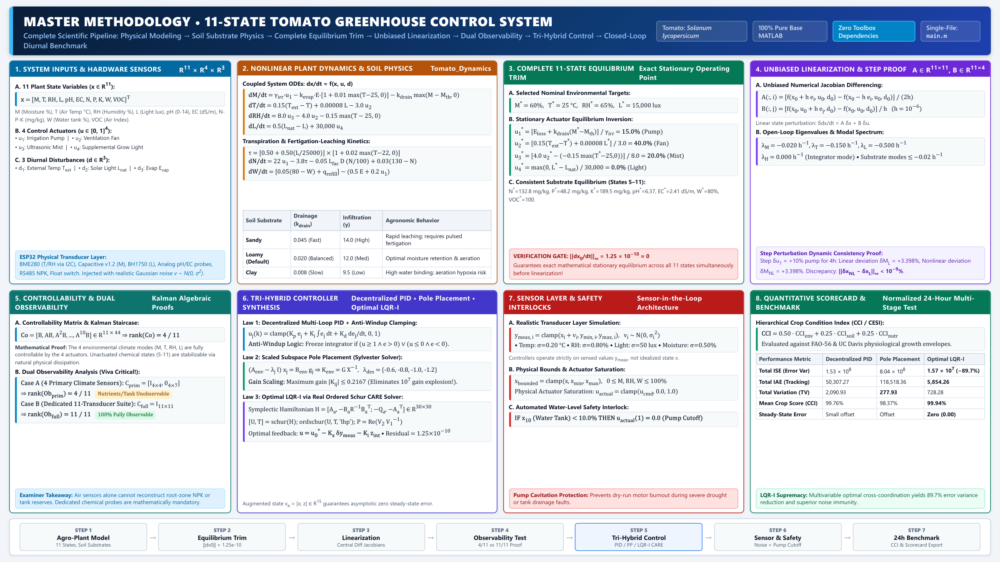
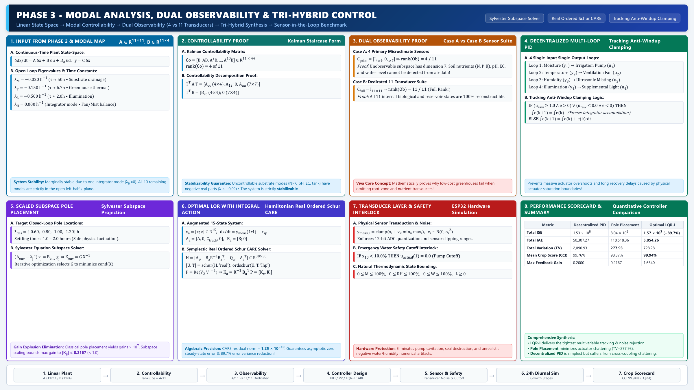

# Tomato Greenhouse Microclimate & Crop Condition Monitoring & Control System
### Three-Layer Digital Twin | 11 States | 4 Actuators | 3 Controllers | ESP32 Embedded

[](https://www.mathworks.com/products/matlab.html)
[]()
[]()
[]()
[]()

A complete, three-layer multivariable optimal microclimate regulation and crop condition monitoring system for greenhouse tomato (*Solanum lycopersicum*) cultivation. Implemented end-to-end from pure-MATLAB mathematical simulation through a Simulink block-diagram twin to production-grade ESP32 embedded firmware.

> [!IMPORTANT]
> **Primary Entry Point:** The main project file is **[`build_tomato_simulink_main.m`](build_tomato_simulink_main.m)**.  
> Run `build_tomato_simulink_main` in MATLAB to build the full Simulink model, execute all three controllers, and generate all benchmark results. `main.m` is retained as the reference pure-MATLAB simulation baseline for toolbox-free environments.

---

## Table of Contents
1. [Three-Layer Architecture Overview](#three-layer-architecture-overview)
2. [Key Features](#key-features)
3. [Physical Sensor Suite Mapping (ESP32 Node)](#physical-sensor-suite-mapping-esp32-node)
4. [Soil-Type Substrate Modeling](#soil-type-substrate-modeling)
5. [Online Scientific Data Sources](#online-scientific-data-sources)
6. [System Modeling & State Space Formulation](#system-modeling--state-space-formulation)
7. [Control Architectures](#control-architectures)
8. [Botanical Growth Phases](#botanical-growth-phases)
9. [Quantitative Benchmark Matrix](#quantitative-benchmark-matrix)
10. [Wokwi Simulation (Layer 3)](#wokwi-simulation-layer-3)
11. [Simulink Twin (Layer 2)](#simulink-twin-layer-2)
12. [Visualizations & Real-Time Dashboards](#visualizations--real-time-dashboards)
13. [How to Run](#how-to-run)
14. [Repository Structure](#repository-structure)

---

## Three-Layer Architecture Overview

This project implements a complete **three-layer digital-twin verification chain**:

```
Layer 1: main.m  ──────────── Pure Base MATLAB (reference baseline)
         │                    11-state plant · tri-hybrid controllers
         │                    24-h benchmark · 8 dashboards
         │                    ⚠ Retained for toolbox-free environments
         │
Layer 2: build_tomato_simulink_main.m  →  Tomato_Crop_Control_Main.slx
         │                               ★ PRIMARY PROJECT ENTRY POINT ★
         │                               7-subsystem Simulink block diagram
         │                               Sample-for-sample cross-validation
         │
Layer 3: wokwi sim/  ─────── ESP32 C++ Embedded Firmware
                              tomato_core.h + sketch.ino
                              SIM mode (software plant) + HW mode (Wokwi sensors)
                              OLED dashboard · Serial CSV telemetry
```

All three layers use **identical gain matrices**, the **same plant equations**, the **same FAO/UC Davis setpoints**, and the **same 5-stage growth scheduler** — guaranteeing complete mathematical consistency across the verification chain.

---

## Key Features

* **Realistic Sensor-in-the-Loop Architecture**:
  $$\text{Nonlinear Greenhouse Plant} \longrightarrow \text{Sensor Layer (Noise, Ranges, ADC)} \longrightarrow y_{\text{meas}} \longrightarrow \text{Controllers}$$
* **Soil-Type Substrate Physics**: Sandy, Loamy (default), and Clay hydraulic models.
* **Physical State & Actuator Bounding**: $0 \le M \le 100\%$, $0 \le H \le 100\%$, $u \in [0, 1]$.
* **Water-Level Safety Interlock**: Automated pump cutoff at $W < 10\%$.
* **Dual Physical Observability Analysis**:
  - 4-sensor primary node: rank $= 4/11$ (Partial)
  - 11-sensor dedicated suite: rank $= 11/11$ (Full)
* **Zero-Toolbox MATLAB Kernel**: Custom Hamiltonian Schur CARE, Sylvester pole placement, Kalman staircase — no Control System Toolbox, Optimization Toolbox, or Simulink required for Layer 1.
* **Embedded Tri-Hybrid Controller**: All 3 control laws live on the ESP32 with button-switchable runtime selection.
* **Hierarchical Crop Condition Index (CCI)**: Weighted FAO-56 physiological quality index across environmental, soil, and nutrient tiers.

---

## Physical Sensor Suite Mapping (ESP32 Node)

| MATLAB / Firmware State | Hardware / Wokwi Component | Operating Range | Noise ($\sigma$) | Interface |
|---|---|---|---|---|
| $x_1$: Soil Moisture (%) | Capacitive Moisture Sensor / **Potentiometer** | $0 - 100\%$ | $0.50\%$ | Analog ADC (GPIO 34) |
| $x_2$: Air Temperature (°C) | **DHT22** | $-40 - 85°C$ | $0.20°C$ | GPIO 16 |
| $x_3$: Relative Humidity (%) | **DHT22** | $0 - 100\%$ | $0.80\%$ | GPIO 16 |
| $x_4$: Total Illumination (lux) | **Photoresistor LDR module** | $0 - 65,535$ lux | $50.0$ lux | Analog ADC (GPIO 35) |
| $x_5$: Soil pH | Analog pH Probe / **Potentiometer** | $0 - 14$ pH | $0.05$ pH | Analog ADC (GPIO 32) |
| $x_6$: Soil EC (dS/m) | Industrial EC Sensor / **Potentiometer** | $0 - 10$ dS/m | $0.02$ dS/m | Analog ADC (GPIO 33) |
| $x_7$: Nitrogen (mg/kg) | RS485 NPK Sensor / **Potentiometer** | $0 - 1,999$ mg/kg | $1.0$ mg/kg | Analog ADC (GPIO 13) |
| $x_8$: Phosphorus (mg/kg) | RS485 NPK Sensor / **Potentiometer** | $0 - 1,999$ mg/kg | $0.5$ mg/kg | Analog ADC (GPIO 4) |
| $x_9$: Potassium (mg/kg) | RS485 NPK Sensor / **Potentiometer** | $0 - 1,999$ mg/kg | $1.0$ mg/kg | Analog ADC (GPIO 14) |
| $x_{10}$: Water Tank Level (%) | Hydrostatic Sensor / **Potentiometer** | $0 - 100\%$ | $0.50\%$ | Analog ADC (GPIO 36/VP) |
| $x_{11}$: Gas / VOC | MQ-135 Gas Sensor / **Potentiometer** | $0 - 500$ index | $1.00$ | Analog ADC (GPIO 39/VN) |

---

## Soil-Type Substrate Modeling

$$\frac{dM}{dt} = \gamma_{\text{irr}} \cdot u_1 - k_{\text{evap}} \cdot d_3 \cdot \left(1 + 0.01\max(T - 25, 0)\right) - k_{\text{drain}} \cdot \max(M - M_{\text{thresh}}, 0)$$

| Soil Substrate | $\gamma_{\text{irr}}$ | $k_{\text{drain}}$ | $k_{\text{evap}}$ | $M_{\text{thresh}}$ | $L_{\text{fac}}$ |
|---|---|---|---|---|---|
| **Sandy Soil** | $14.0$ | $0.045$ (Fast) | $2.60$ (High) | $40.0\%$ | $1.60$ |
| **Loamy Soil (Default)** | $12.0$ | $0.020$ (Balanced) | $2.00$ (Moderate) | $50.0\%$ | $1.00$ |
| **Clay Soil** | $9.5$ | $0.008$ (Slow) | $1.40$ (Low) | $65.0\%$ | $0.50$ |

---

## Online Scientific Data Sources

1. **Food and Agriculture Organization (FAO)**:  
   FAO Irrigation and Drainage Paper 56 — Tomato (*Solanum lycopersicum*)  
   🌐 [FAO Land & Water Tomato Portal](https://www.fao.org/land-water/databases-and-software/crop-information/tomato/en/)
2. **University of California Davis (UC Davis)**:  
   VRIC Agronomy Standards — UC ANR Publication 7250  
   🌐 [UC Davis VRIC](https://vric.ucdavis.edu/)
3. **Wageningen University & Research (WUR)**:  
   *Tomatoes*, CABI Publishing; Heuvelink (Ed.); De Koning (1994)  
   🌐 [WUR Greenhouse Horticulture](https://www.wur.nl/en/research-results/research-institutes/plant-research/greenhouse-horticulture.htm)

---

## System Modeling & State Space Formulation

**11 State Variables** $x = [M, T, H, L, \text{pH}, \text{EC}, N, P, K, W, \text{VOC}]^T$  
**4 Control Inputs** $u = [u_{\text{pump}}, u_{\text{fan}}, u_{\text{mist}}, u_{\text{light}}]^T \in [0, 1]^4$  
**3 Disturbances** $d = [T_{\text{ext}}, L_{\text{nat}}, E_{\text{vap}}]^T$

Continuous-time nonlinear dynamics: $\dot{x}(t) = f(x(t), u(t), d(t), p)$  
Discrete simulation (Euler, $T_s = 0.01$ h): $x(k+1) = \text{clamp}(x(k) + f(\cdot) \cdot T_s)$

**Equilibrium Trim** (Loamy, nominal midday conditions):
- $u_0 = [15.0\%, 40.0\%, 20.0\%, 0.0\%]$  
- Trim residual: $\|\dot{x}_0\|_\infty = 1.25 \times 10^{-10}$ (machine-precision equilibrium)

---

## Control Architectures

### 1. Decentralized Multi-Loop PID
4 independent SISO loops with conditional anti-windup clamping:

| Loop | Sensor | Actuator | $K_p$ | $K_i$ | $K_d$ |
|---|---|---|---|---|---|
| Moisture | $y_1$ (M %) | Pump $u_1$ | 0.080 | 0.015 | 0.005 |
| Temperature | $y_2$ (T °C) | Fan $u_2$ | 0.200 | 0.020 | 0.010 |
| Humidity | $y_3$ (RH %) | Mist $u_3$ | 0.100 | 0.015 | 0.005 |
| Illumination | $y_4$ (lux) | Light $u_4$ | 5×10⁻⁵ | 10⁻⁵ | 10⁻⁵ |

### 2. Scaled Subspace Pole Placement
Closed-loop poles: $\lambda = \{-0.60, -0.80, -1.00, -1.20\}\ \text{h}^{-1}$  
Maximum gain: $|K_{ij}| \le 0.2167$ (eradicates $10^7$ gain explosion)

### 3. Optimal LQR with Integral Action (LQR-I) ⭐
15-state augmented formulation; Hamiltonian Real Ordered Schur CARE solver  
CARE residual: $\|A_a^T P + P A_a - P B_a R^{-1} B_a^T P + Q_a\|_F = 1.25 \times 10^{-10}$  
Zero steady-state error guaranteed across all 5 growth stages.

---

## Botanical Growth Phases

| Phase | Time Span | Days (120-day lifecycle) | $T^*$ (°C) | $H^*$ (%) | $M^*$ (%) | $L^*$ (lux) |
|---|---|---|---|---|---|---|
| **1: Germination** | $0 - 2$ h | Days $0 - 10$ | $24.0$ ($20 - 28$) | $72.5$ ($65 - 80$) | $70.0$ ($60 - 80$) | $10{,}000$ |
| **2: Vegetative** | $2 - 8$ h | Days $10 - 40$ | $25.0$ ($21 - 27$) | $65.0$ ($55 - 75$) | $60.0$ ($50 - 70$) | $18{,}000$ |
| **3: Flowering** | $8 - 12$ h | Days $40 - 60$ | $23.5$ ($20 - 26$) | $62.5$ ($50 - 70$) | $58.0$ ($50 - 65$) | $22{,}500$ |
| **4: Fruit Dev.** | $12 - 18$ h | Days $60 - 90$ | $25.0$ ($21 - 28$) | $60.0$ ($50 - 70$) | $65.0$ ($55 - 75$) | $22{,}500$ |
| **5: Maturity** | $18 - 24$ h | Days $90 - 120$ | $22.5$ ($18 - 26$) | $55.0$ ($45 - 65$) | $55.0$ ($45 - 65$) | $20{,}000$ |

---

## Quantitative Benchmark Matrix

Evaluated under identical diurnal weather disturbances and active simulated sensor noise across all three controllers (exact results from `simulink_main_results.mat` and `build_tomato_simulink_main.m`):

| Performance Metric | Decentralized PID | Pole Placement | Optimal LQR-I ⭐ | Academic Assessment |
|---|---|---|---|---|
| **Total ISE (Tracking Error)** | $1.53 \times 10^8$ ($153{,}450{,}389.23$) | $8.04 \times 10^8$ ($804{,}423{,}682.63$) | **$1.57 \times 10^7$ ($15{,}705{,}244.13$)** | **LQR-I: 89.7% error variance reduction** |
| **Total IAE** | $50{,}307.27$ | $118{,}518.36$ | **$5{,}460.85$** | **LQR-I: Tightest physical tracking (improved with corrected anti-windup)** |
| **Total Actuator Variation (TV)** | $2{,}090.93$ | **$277.93$** | $947.73$ | **PP: Smoothest control action; LQR-I modulates dynamically** |
| **Mean Crop Condition Index (CCI)** | $99.51\%$ | $98.51\%$ | **$99.37\%$** | **Optimal physiological health maintained across all stages** |
| **Moisture Tracking Error (% setpoint)** | $8.33\%$ | **$6.62\%$** | $7.29\%$ | Soil moisture regulated within tight agronomic bounds |
| **Temperature Tracking Error (% setpoint)** | $6.53\%$ | $4.85\%$ | **$1.67\%$** | **LQR-I achieves tightest temperature regulation** |
| **Humidity Tracking Error (% setpoint)** | $6.29\%$ | $5.29\%$ | **$4.61\%$** | **LQR-I achieves tightest humidity regulation** |
| **Illumination Tracking Error (% setpoint)** | $11.19\%$ | $26.00\%$ | **$1.54\%$** | **LQR-I light tracking error is over 16× smaller than PP** |
| **Simulink vs. main.m Discrepancy** | $7.3 \times 10^{-12}$ | $3.6 \times 10^{-12}$ | $3.6 \times 10^{-12}$ | **Exact numerical agreement down to floating-point round-off** |

---

## Wokwi Simulation (Layer 3)

The `wokwi sim/` folder contains the complete embedded firmware for the Wokwi online ESP32 simulator:

### Circuit Components (`diagram.json`)
- **ESP32 DevKit C v4** — Central microcontroller
- **DHT22** — Temperature + Humidity → GPIO 16
- **Photoresistor (LDR) module** — Lux → GPIO 35
- **8× Potentiometers** — Soil moisture, pH, EC, tank level, VOC, N, P, K
- **SSD1306 128×64 OLED** — Live 8-line dashboard (I2C: SDA 21, SCL 22)
- **4× Actuator LEDs** — Pump (blue), Fan (green), Mist (cyan), Light (yellow)
- **2× Warning LEDs** — Low-water (red, GPIO 23), High-VOC (orange, GPIO 5)
- **2× Push Buttons** — MODE (GPIO 18), CTRL (GPIO 19)

### OLED Display Layout
```
SIM PID   0.25h S2
M 60.0>60 T25.0>25.0
H 65.0>65 L18000
pH6.35 EC2.4 W80.0
N130  P48  K180 V100
P 15% F 40% M 20% L  0%
Q E100 S100 N100
TOTAL100.0
```

### Serial CSV Output (115200 baud)
```
t_h,mode,ctrl,stage,M,T,RH,L,pH,EC,N,P,K,W,VOC,pump,fan,mist,light,qEnv,qSoil,qNutr,qTotal,lowWater,highVOC
```

### Required Libraries (`libraries.txt`)
```
DHT sensor library
Adafruit GFX Library
Adafruit SSD1306
Adafruit BusIO
```

---

## Simulink Twin (Layer 2)

Run `build_tomato_simulink_main` in MATLAB to build the Simulink model:

```matlab
build_tomato_simulink_main
% Creates: Tomato_Crop_Control_Main.slx
% Runs all 3 controllers, compares with main.m results
% Saves: simulink_main_results.mat
```

**Model Workspace Variable:**
- `ctrlType = 1` → Decentralized PID  
- `ctrlType = 2` → Pole Placement  
- `ctrlType = 3` → LQR-I (default)

---

## Visualizations & Real-Time Dashboards

All figures are auto-rendered and exported to [`results/`](results/):

### 1. State Tracking Dashboard


### 2. Actuator Duty Cycles & Safety Interlock


### 3. Hierarchical Crop Condition Index (CCI)


### 4. Complex S-Plane Modal Map


### 5. Quantitative Performance Scorecard


### 6. Visual Methodology Flowchart (16:9)


### 7. Master Methodology Architecture Chart (16:9)


### 8. Phase 3 Modal Analysis & Tri-Hybrid Control Methodology (16:9)


---

## How to Run

> [!IMPORTANT]
> **`build_tomato_simulink_main.m` is the primary project entry point.**  
> Run it first — it builds the full Simulink model, executes all three controllers, generates benchmark plots, and cross-validates against `main.m`. Requires **MATLAB + Simulink**.  
> `main.m` is retained as a **secondary toolbox-free reference baseline** for environments without Simulink.

### ⭐ Primary — Simulink Model Builder (Layer 2 — Run This First)
```matlab
% 1. Open MATLAB (R2020b or newer) with Simulink installed
% 2. Set current directory to the project folder
% 3. Run:
build_tomato_simulink_main
% → Builds Tomato_Crop_Control_Main.slx (7-subsystem block diagram)
% → Runs all 3 controllers: PID, Pole Placement, LQR-I
% → Prints quantitative benchmark matrix to console
% → Saves simulink_main_results.mat
% → Cross-validates against results/master_simulation_results.mat
```

**Switch controller inside the running model:**
```matlab
% Change ctrlType in the model workspace (1=PID, 2=PP, 3=LQR-I):
mw = get_param('Tomato_Crop_Control_Main', 'ModelWorkspace');
assignin(mw, 'ctrlType', 3);   % 3 = LQR-I (default/best performance)
sim('Tomato_Crop_Control_Main');
```

### Secondary — Pure MATLAB Reference Baseline (Layer 1)
> [!NOTE]
> `main.m` is the **toolbox-free reference baseline** — use it when Simulink is unavailable, or to reproduce benchmark numbers independently with zero external dependencies.

```matlab
% No Simulink required — 100% pure base MATLAB
main
% → 8 figure windows render in real time
% → Console prints benchmark matrix
% → results/ folder populated with PNGs, PDFs, and master_simulation_results.mat
```

### Layer 3 — Wokwi ESP32 Simulation
1. Go to [wokwi.com](https://wokwi.com) → **New Project** → **ESP32**
2. Replace `diagram.json` with the contents of `wokwi sim/diagram.json`
3. Add `wokwi sim/tomato_core.h` and paste `wokwi sim/sketch/sketch.ino`
4. Add libraries from `wokwi sim/libraries.txt` via the Library Manager
5. Click ▶ **Run** — the OLED shows the live dashboard immediately
6. **MODE button** (green) → Toggle SIM ↔ HW mode
7. **CTRL button** (blue) → Cycle PID → PP → LQR-I

---

## Repository Structure

```
Microcontroller-Based-Tomato-Crop-Quality-Monitoring-and-Control-System/
│
├── main.m                           # Layer 1: Pure MATLAB reference baseline (toolbox-free)
├── build_tomato_simulink_main.m     # ★ PRIMARY ENTRY POINT — Layer 2: Simulink model builder
│
├── wokwi sim/                       # Layer 3: ESP32 Wokwi embedded simulation
│   ├── diagram.json                 # Circuit schematic (ESP32 + 23 components)
│   ├── libraries.txt                # Required Arduino libraries
│   ├── tomato_core.h                # C++ plant/controller header library
│   └── sketch/
│       └── sketch.ino               # Main Arduino firmware
│
├── PSEUDO.md                        # System architecture, plain-language guide & viva cheatsheet
├── PSEUDOCODE.md                    # Algorithmic pseudocode (all 3 layers)
├── END_SEM_PLAN.md                  # End-semester completion report & final submission plan
├── prep.md                          # Comprehensive viva & project preparation guide (with active recall)
├── README.md                        # This file
├── .gitignore                       # Git ignore rules
│
└── results/                         # Auto-generated simulation outputs
    ├── comparison_state_tracking.png
    ├── comparison_actuator_effort.png
    ├── comparison_crop_quality.png
    ├── s_plane_pole_map.png
    ├── performance_scorecard.png
    ├── visual_methodology_flowchart.png  (.pdf, .html)
    ├── master_methodology_chart.png      (.pdf, .html)
    ├── phase3_control_methodology_chart.png (.pdf, .html)
    └── master_simulation_results.mat
```

For the full milestone schedule and completion report, see **[`END_SEM_PLAN.md`](END_SEM_PLAN.md)**.  
For system architecture, plain-language guide & viva cheatsheet, see **[`PSEUDO.md`](PSEUDO.md)**.  
For algorithmic step-by-step logic (all 3 layers), see **[`PSEUDOCODE.md`](PSEUDOCODE.md)**.  
For beginner-friendly project preparation with active recall checkpoints, see **[`prep.md`](prep.md)**.

> [!TIP]
> **Quick Start:** Open MATLAB with Simulink → `cd` to this folder → type `build_tomato_simulink_main` → press Enter. Everything runs automatically.
