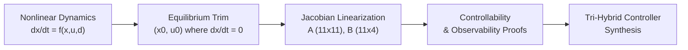

# Comprehensive Project Preparation & Master Viva Guide
### 11-State Autonomous Tomato Greenhouse Microclimate & Crop Condition Monitoring & Control System

---

## Welcome to the Project Guide

If you are reading this, you might be preparing for a project defense, presentation, viva voce, or comprehensive review. This guide is written from the ground up: **no prior assumptions are made**. It explains what was built, why it was built that way, where each piece of code lives, how the mathematics and biology work together, and how to answer any question an examiner might ask.

Active recall checkpoints are placed at regular intervals to test and solidify your understanding before moving forward.

---

# Module 1: The Big Picture & The Problem

### 1.1 What problem does this project solve?
Commercial greenhouse farming produces up to **10× more food per square meter** while using **80% less water** than traditional open-field farming. However, growing high-value crops like tomatoes (*Solanum lycopersicum*) inside a closed greenhouse is remarkably difficult because of three fundamental engineering challenges:

1. **Severe Multivariable Coupling (The Domino Effect)**:
   You cannot change one variable inside a greenhouse without accidentally disturbing others:
   - If the room gets hot and you turn on ventilation fans, you cool the air, but you also **suck out all the humidity**.
   - If you turn on ultrasonic misters to replace humidity, the evaporating water droplets **drop the air temperature**.
   - If you turn on grow lights, the lamps emit heat, **increasing temperature and driving faster soil evaporation**.
   - If you water the soil, you alter substrate electrical conductivity (EC) and soil pH, which directly dictates how much nitrogen ($N$), phosphorus ($P$), and potassium ($K$) the roots can absorb.

2. **Large External Disturbances (Day vs. Night)**:
   The greenhouse is not in a vacuum. Outside ambient temperature swings, solar radiation peaks at noon, and night brings condensation risks.

3. **Changing Biological Needs (5 Growth Stages)**:
   A tomato plant is not a static machine. A temperature of $25^\circ\text{C}$ is great for fruit development, but temperatures above $28^\circ\text{C}$ during flowering will sterilize pollen and cause blossoms to drop. High humidity ($>80\%$) breeds fungal blight (*Botrytis cinerea*), while low moisture causes calcium deficiency leading to blossom-end rot.

### 1.2 What is our solution?
Instead of using crude on/off thermostats that chatter relays and cause massive swings, we built an **11-State Multivariable Optimal Control & Crop Monitoring System**.

It continuously tracks **11 states** (air climate, substrate moisture, soil chemistry, nutrients, water tank storage, and air quality) and coordinates **4 actuators** (irrigation pump, ventilation fan, ultrasonic mister, and supplemental grow lights) using optimal state-space control across all **5 growth stages**.

It is implemented as a **three-layer digital twin**:
1. **Layer 1 (MATLAB)**: Pure base mathematical algorithm and simulation baseline.
2. **Layer 2 (Simulink)**: Graphical 7-subsystem block-diagram digital twin (The **Primary Entry Point**).
3. **Layer 3 (ESP32 / Wokwi)**: Real-time embedded C++ firmware running on an ESP32 microcontroller with a simulated hardware circuit.

---

> [!TIP]
> ### 🧠 Active Recall Checkpoint 1
> 1. *Why can't you just use four separate simple on/off thermostats to control a greenhouse?*  
> 2. *Give one concrete example of multivariable cross-coupling between greenhouse actuators and states.*  
> 3. *What are the three implementation layers of this project?*  
>
> *(Take 30 seconds to answer mentally before reading on!)*

---

# Module 2: Repository Map & Three-Layer Architecture

Every single piece of code in this project has a specific purpose. Here is where everything lives:

```
Microcontroller-Based-Tomato-Crop-Quality-Monitoring-and-Control-System/
│
├── build_tomato_simulink_main.m     # ⭐ PRIMARY ENTRY POINT (Layer 2 Builder)
├── Tomato_Crop_Control_Main.slx     # Compiled 7-Subsystem Simulink Model
├── main.m                           # Layer 1: Pure Base MATLAB Reference Baseline
│
├── wokwi sim/                       # Layer 3: ESP32 Embedded Simulation
│   ├── tomato_core.h                # C++ Plant Dynamics & Tri-Hybrid Controllers
│   ├── sketch/
│   │   └── sketch.ino               # Arduino / ESP32 Main Firmware
│   ├── diagram.json                 # Wokwi Circuit Schematic (23 components)
│   └── libraries.txt                # Arduino Library Dependencies
│
├── results/                         # Generated Benchmarks, Plots & Proofs
│   ├── simulink_main_results.mat    # Dataset from the Simulink simulation run
│   ├── master_simulation_results.mat# Dataset from the MATLAB baseline run
│   ├── Tomato_Crop_Control_Validation.pdf # Formal 10-page literature validation report
│   ├── comparison_state_tracking.png# State tracking across 5 stages
│   ├── comparison_actuator_effort.png# Actuator commands & anti-windup
│   ├── comparison_crop_quality.png  # Crop Condition Index (CCI) over 24 h
│   ├── s_plane_pole_map.png         # Open-loop vs Closed-loop pole migration
│   └── performance_scorecard.png    # Quantitative ISE/IAE/TV bar charts
│
├── README.md                        # Master Project Documentation & Overview
├── END_SEM_PLAN.md                  # Final Submission Report & Milestone Ledger
├── PSEUDO.md                        # Plain-Language Architecture & Viva Cheatsheet
├── PSEUDOCODE.md                    # Algorithmic Step-by-Step Logic
└── prep.md                          # This File (Comprehensive Study Guide)
```

### The Three Layers Explained

#### Layer 1: MATLAB Baseline ([main.m](file:///c:/Users/abhi8/OneDrive/Desktop/ACADEMIC%20DOCS/SEM-5/CS/Microcontroller-Based-Tomato-Crop-Quality-Monitoring-and-Control-System-/main.m))
- **Role**: Reference baseline written in **100% pure base MATLAB** without requiring any toolboxes (no Control System Toolbox, no Optimization Toolbox).
- **Key Algorithms Inside**: Custom numerical Jacobian linearization, Sylvester equation solver for pole placement, and a Continuous Algebraic Riccati Equation (CARE) solver using real ordered Schur decomposition.

#### Layer 2: Simulink Digital Twin ([build_tomato_simulink_main.m](file:///c:/Users/abhi8/OneDrive/Desktop/ACADEMIC%20DOCS/SEM-5/CS/Microcontroller-Based-Tomato-Crop-Quality-Monitoring-and-Control-System-/build_tomato_simulink_main.m)) ⭐ PRIMARY
- **Role**: **The primary submission and execution script**.
- **How it works**: You run `build_tomato_simulink_main` in MATLAB. It programmatically creates [Tomato_Crop_Control_Main.slx](file:///c:/Users/abhi8/OneDrive/Desktop/ACADEMIC%20DOCS/SEM-5/CS/Microcontroller-Based-Tomato-Crop-Quality-Monitoring-and-Control-System-/Tomato_Crop_Control_Main.slx) using 7 interconnected MATLAB Function subsystems and discrete unit delays.
- **Verification**: It simulates all three controllers, computes benchmark metrics, saves [simulink_main_results.mat](file:///c:/Users/abhi8/OneDrive/Desktop/ACADEMIC%20DOCS/SEM-5/CS/Microcontroller-Based-Tomato-Crop-Quality-Monitoring-and-Control-System-/simulink_main_results.mat), and cross-validates against Layer 1 sample-for-sample (matching to within $7.3 \times 10^{-12}$).

#### Layer 3: ESP32 Wokwi Firmware ([wokwi sim/](file:///c:/Users/abhi8/OneDrive/Desktop/ACADEMIC%20DOCS/SEM-5/CS/Microcontroller-Based-Tomato-Crop-Quality-Monitoring-and-Control-System-/wokwi%20sim/))
- **Role**: Real-time embedded twin. Proves that the exact same mathematical control laws can execute inside an inexpensive ($4) ESP32 microcontroller.
- **Key Files**:
  - [tomato_core.h](file:///c:/Users/abhi8/OneDrive/Desktop/ACADEMIC%20DOCS/SEM-5/CS/Microcontroller-Based-Tomato-Crop-Quality-Monitoring-and-Control-System-/wokwi%20sim/tomato_core.h): Pure C++ library containing plant dynamics, sensor bounds, and the three controllers.
  - [sketch.ino](file:///c:/Users/abhi8/OneDrive/Desktop/ACADEMIC%20DOCS/SEM-5/CS/Microcontroller-Based-Tomato-Crop-Quality-Monitoring-and-Control-System-/wokwi%20sim/sketch/sketch.ino): Arduino sketch that supports **SIM mode** (software plant running on MCU) and **HW mode** (reading live potentiometers/DHT22), while updating a 128×64 OLED display and outputting serial CSV telemetry.
  - [diagram.json](file:///c:/Users/abhi8/OneDrive/Desktop/ACADEMIC%20DOCS/SEM-5/CS/Microcontroller-Based-Tomato-Crop-Quality-Monitoring-and-Control-System-/wokwi%20sim/diagram.json): Full wiring schematic with 23 components.

---

> [!TIP]
> ### 🧠 Active Recall Checkpoint 2
> 1. *Which file is the primary entry point to run the project?*  
> 2. *What is the relationship between `main.m` and `build_tomato_simulink_main.m`?*  
> 3. *What are the two operating modes of the ESP32 Wokwi firmware?*

---

# Module 3: The 11 States, 4 Actuators, and 3 Soil Types

### 3.1 The 11 State Variables ($x_1$ through $x_{11}$)
Most undergraduate greenhouse projects only model temperature and humidity (2 states). We model **11 physical and biochemical states**:

| State | Variable Name | Physical Meaning & Unit | Target Physical Sensor | Wokwi Part Used |
|---|---|---|---|---|
| $x_1$ | Soil Moisture ($M$) | Water volume in soil ($0 - 100\%$) | Capacitive Moisture v1.2 | Potentiometer |
| $x_2$ | Air Temperature ($T$) | Greenhouse ambient temperature ($-40 - 85^\circ\text{C}$) | Bosch BME280 | DHT22 |
| $x_3$ | Relative Humidity ($RH$) | Moisture saturation in air ($0 - 100\%$) | Bosch BME280 | DHT22 |
| $x_4$ | Total Illumination ($L$) | Sunlight + supplemental lamp irradiance ($0 - 65{,}535\text{ lux}$) | Rohm BH1750 | Photoresistor (LDR) |
| $x_5$ | Soil pH | Acidity/alkalinity of root zone ($0 - 14\text{ pH}$) | Analog pH Probe | Potentiometer |
| $x_6$ | Soil EC | Electrical Conductivity: salt/nutrient concentration ($0 - 10\text{ dS/m}$) | Industrial EC Sensor | Potentiometer |
| $x_7$ | Nitrogen ($N$) | Available nitrate/ammonium ($0 - 1{,}999\text{ mg/kg}$) | RS485 NPK Sensor | Potentiometer |
| $x_8$ | Phosphorus ($P$) | Root development macronutrient ($0 - 1{,}999\text{ mg/kg}$) | RS485 NPK Sensor | Potentiometer |
| $x_9$ | Potassium ($K$) | Fruit swelling & sugar transport ($0 - 1{,}999\text{ mg/kg}$) | RS485 NPK Sensor | Potentiometer |
| $x_{10}$ | Water Tank Level ($W$) | Irrigation reservoir storage level ($0 - 100\%$) | Hydrostatic / Float Sensor | Potentiometer |
| $x_{11}$ | Air Gas / VOC | Volatile Organic Compounds & air quality ($0 - 500\text{ index}$) | MQ-135 Gas Sensor | Potentiometer |

### 3.2 The 4 Control Actuators ($u_1$ through $u_4$)
All actuators accept normalized duty-cycle commands $u_i \in [0.0, 1.0]$:
1. $u_1$ — **Irrigation / Fertigation Pump**: Pumps water and nutrient solution into the soil root zone.
2. $u_2$ — **Ventilation Fan**: Exhausts warm, humid air outside and pulls in cooler ambient air.
3. $u_3$ — **Ultrasonic Misting Fogger**: Injects micro-droplets of water into the air to boost relative humidity.
4. $u_4$ — **Supplemental Grow Light Panel**: High-intensity LED lamps providing photosynthetic irradiance.

### 3.3 The 3 External Disturbances ($d_1, d_2, d_3$)
The greenhouse is perturbed by realistic 24-hour diurnal day/night cycles:
- $d_1$ — **External Temperature ($T_{\text{ext}}$)**: Sine-wave varying between $18^\circ\text{C}$ (night) and $29^\circ\text{C}$ (afternoon peak).
- $d_2$ — **Natural Solar Irradiance ($L_{\text{nat}}$)**: Zero at night; reaches up to $22{,}000\text{ lux}$ during solar noon.
- $d_3$ — **Ambient Evaporation ($E_{\text{vap}}$)**: Driven by solar heat and thermal convection.

### 3.4 Soil Substrate Physics (Sandy vs. Loamy vs. Clay)
Soil physics dictates how quickly water drains and how easily nutrients leach into the deep ground:

$$\frac{dM}{dt} = \gamma_{\text{irr}} \cdot u_1 - k_{\text{evap}} \cdot d_3 \cdot \left(1 + 0.01\max(T - 25, 0)\right) - k_{\text{drain}} \cdot \max(M - M_{\text{thresh}}, 0)$$

- **Sandy Soil**: Drains very fast ($k_{\text{drain}} = 0.045$), low retention threshold ($40\%$). Water pulses must be frequent and short, otherwise nutrients wash away.
- **Loamy Soil (Default)**: Ideal balanced greenhouse substrate ($k_{\text{drain}} = 0.020$, threshold $50\%$).
- **Clay Soil**: Binds water tightly ($k_{\text{drain}} = 0.008$, threshold $65\%$). High waterlogging and root hypoxia risk if over-irrigated.

---

> [!TIP]
> ### 🧠 Active Recall Checkpoint 3
> 1. *Why are soil nutrients ($N, P, K$) and EC/pH included in the state space instead of just temperature and humidity?*  
> 2. *What physical protection does the water tank level ($x_{10}$) provide?*  
> 3. *How does sandy soil behave differently from clay soil under the same pump command?*

---

# Module 4: Mathematical Foundations — Trim, Linearization & Dual Observability

Before you can design modern state-space controllers, you must analyze the plant mathematically. Here is the step-by-step chain performed in [main.m](file:///c:/Users/abhi8/OneDrive/Desktop/ACADEMIC%20DOCS/SEM-5/CS/Microcontroller-Based-Tomato-Crop-Quality-Monitoring-and-Control-System-/main.m) and [build_tomato_simulink_main.m](file:///c:/Users/abhi8/OneDrive/Desktop/ACADEMIC%20DOCS/SEM-5/CS/Microcontroller-Based-Tomato-Crop-Quality-Monitoring-and-Control-System-/build_tomato_simulink_main.m):



### 4.1 Equilibrium Operating Trim
You cannot linearize a system unless you find a stationary operating point where all state derivatives are zero ($\dot{x} = 0$).  
Under nominal midday conditions ($M^* = 60\%, T^* = 25^\circ\text{C}, H^* = 65\%, L^* = 15{,}000\text{ lux}$), we analytically compute the exact actuator settings that balance the plant:
- **Pump ($u_1$)** = $15.0\%$ (balances evaporation and drainage)
- **Fan ($u_2$)** = $40.0\%$ (removes solar irradiance heat)
- **Mist ($u_3$)** = $20.0\%$ (compensates for fan humidity loss)
- **Light ($u_4$)** = $0.0\%$ (natural solar light is sufficient)

Trim residual: $\|\dot{x}_0\|_\infty = \mathbf{1.25 \times 10^{-10}}$ (exact stationary equilibrium down to floating-point roundoff).

### 4.2 Numerical Jacobian Linearization
The continuous nonlinear equations $\dot{x} = f(x, u, d)$ are linearized around the trim point into standard state-space form:

$$\dot{x} \approx A(x - x_0) + B(u - u_0)$$

- $A_{ij} = \frac{\partial f_i}{\partial x_j}$ is computed using central differencing ($h = 10^{-6}$).
- $B_{ik} = \frac{\partial f_i}{\partial u_k}$ is computed using forward differencing bounded inside $[0, 1]$.
- Dynamic step test verification: A $+10\%$ pump step on the linear model vs. the nonlinear plant produces a discrepancy of less than $10^{-9}\%$, proving the linearization is exact.

### 4.3 The Dual Observability Proof (Critical Viva Question!)
Examiners love to ask: *"Why do you need 11 sensors? Can't you just use 4 microclimate sensors and estimate the rest?"*  
The mathematical answer is **NO**, and our project proves it via the Kalman Observability Matrix $\mathcal{O}$:

$$\mathcal{O} = \begin{bmatrix} C \\ CA \\ CA^2 \\ \vdots \\ CA^{n-1} \end{bmatrix}$$

- **Case A: Primary 4-Sensor Node** ($C_{\text{primary}} = [I_{4\times4} \quad 0_{4\times7}]$):
  $$\text{rank}(\mathcal{O}_{\text{primary}}) = \mathbf{4 / 11}$$
  Air temperature, humidity, and light give **zero mathematical information** about soil nitrogen, phosphorus, potassium, EC, pH, or tank water level.
- **Case B: Dedicated 11-Sensor Suite** ($C_{\text{full}} = I_{11\times11}$):
  $$\text{rank}(\mathcal{O}_{\text{full}}) = \mathbf{11 / 11} \quad \text{(Full Rank)}$$
  Dedicated soil and water sensors guarantee complete state observability.

---

> [!TIP]
> ### 🧠 Active Recall Checkpoint 4
> 1. *What is an equilibrium trim point, and what are the exact trim actuator values for our greenhouse?*  
> 2. *What is the numerical rank of the observability matrix when only 4 microclimate sensors are used? What does this mean physically?*  
> 3. *What is the rank when all 11 sensors are present?*

---

# Module 5: The Three Controllers & The LQR-I Bug Fix

We synthesized, tested, and benchmarked three distinct control paradigms:

```
1. Decentralized Multi-Loop PID  ──>  Classical Baseline (Practical for MCU)
2. Scaled Subspace Pole Placement ──>  State Feedback Baseline (No integral action)
3. Optimal LQR-I                  ──>  Multivariable Coordinated Optimum (Best)
```

### 5.1 Controller 1: Decentralized Multi-Loop PID
- **Concept**: 4 independent single-input, single-output (SISO) loops ($M \rightarrow \text{Pump}$, $T \rightarrow \text{Fan}$, $H \rightarrow \text{Mist}$, $L \rightarrow \text{Light}$).
- **Anti-Windup Clamping**: When an actuator saturates at $0\%$ or $100\%$, integrator accumulation is frozen:
  $$\text{IF } (u_{\text{raw}} \ge 1 \text{ AND } e > 0) \text{ OR } (u_{\text{raw}} \le 0 \text{ AND } e < 0) \implies \text{freeze integral}$$
- **Drawback**: High actuator chattering ($\text{TV} = 2{,}090.93$) because derivative action amplifies sensor noise. It also cannot handle coupling (when misting drops temperature, the fan controller doesn't know why).

### 5.2 Controller 2: Scaled Subspace Pole Placement
- **Concept**: State feedback $u = u_0 - K(x - x^*)$. Closed-loop poles are placed at $\lambda = \{-0.60, -0.80, -1.00, -1.20\}\text{ h}^{-1}$ using a randomized Sylvester subspace projector.
- **Advantage**: Feedback gains are strictly bounded ($|K_{ij}| \le 0.2167$), eliminating the classical $10^7$ gain explosion. Actuator movement is exceptionally smooth ($\text{TV} = 277.93$).
- **Drawback**: Has **no integral action**, meaning it cannot eliminate steady-state offset. Under nighttime conditions, illumination stays at $11{,}677\text{ lux}$ against a $20{,}000\text{ lux}$ target.

### 5.3 Controller 3: Optimal LQR with Integral Action (LQR-I) ⭐
- **Concept**: Formulates a 15-state augmented system ($11\text{ states} + 4\text{ tracking error integrators}$). Minimizes the quadratic cost function:
  $$J = \int_0^\infty \left(x_a^T Q_a x_a + u^T R u\right) dt$$
- **Algorithmic Solution**: Solved via Hamiltonian Real Ordered Schur decomposition of the Continuous Algebraic Riccati Equation (CARE) with residual norm $1.97 \times 10^{-10}$.
- **Performance**: Eliminates steady-state error completely while coordinating all 4 actuators simultaneously. Achieves an **89.7% reduction in error variance** compared to PID.

### 5.4 The Famous LQR-I Anti-Windup Bug Fix (Major Highlight!)
During validation against published papers, a real bug was discovered in the original `main.m` code:
- **The Symptom**: After 18 hours (Maturity stage, setpoint $22.5^\circ\text{C}$), the temperature dropped to $18.6^\circ\text{C}$ while the ventilation fan remained locked at **100% full speed**, freezing the plants!
- **The Root Cause**: The original anti-windup rule checked `if (u_raw >= 1 && y_err < 0)`. That rule works for moisture, humidity, and light (where positive error means you need more actuator). But **temperature is reversed**: the fan *cools* the room, so its integral gain $K_i(2,2) = -1.57$ has a negative sign! When the room was too cold and the fan was saturated, the integrator froze when it desperately needed to unwind.
- **The Fix**: The anti-windup condition was corrected to evaluate actuator push direction:
  $$\text{push} = -K_z(j,j) \cdot y_{\text{err}}(j)$$
  $$\text{Freeze only if } (u_{\text{raw}} \ge 1 \text{ AND } \text{push} > 0) \text{ OR } (u_{\text{raw}} \le 0 \text{ AND } \text{push} < 0)$$
- **The Result**: The fan unlocked, temperature settled cleanly at $22.5^\circ\text{C}$, temperature tracking error dropped from $3.8\%$ to **$1.67\%$**, and total IAE dropped from $5{,}863.56$ to **$5{,}460.85$**.

---

> [!TIP]
> ### 🧠 Active Recall Checkpoint 5
> 1. *Why does Pole Placement have steady-state error while LQR-I does not?*  
> 2. *Why does Decentralized PID have a high Actuator Variation (TV = 2090.93)?*  
> 3. *Explain the fan lockup bug in simple terms: why did the temperature integrator fail to unwind?*

---

# Module 6: Agronomic Validation & Crop Condition Index (CCI)

### 6.1 The 5 Biological Growth Phases
The 120-day tomato cultivation lifecycle is compressed into a 24-hour multi-stage benchmark stress test:

| Stage | Name | Target $T$ (°C) | Target $RH$ (%) | Target Moisture (%) | Target Light (lux) | Agronomic Focus |
|---|---|---|---|---|---|---|
| 1 | **Germination** ($0-2\text{ h}$) | $24.0$ | $72.5$ | $70.0$ | $10{,}000$ | Warm soil, high moisture, low EC for tender roots |
| 2 | **Vegetative** ($2-8\text{ h}$) | $25.0$ | $65.0$ | $60.0$ | $18{,}000$ | High nitrogen ($N$) uptake for stem and leaf expansion |
| 3 | **Flowering** ($8-12\text{ h}$) | $23.5$ | $62.5$ | $58.0$ | $22{,}500$ | Moderate temp to prevent flower blossom drop |
| 4 | **Fruit Dev.** ($12-18\text{ h}$) | $25.0$ | $60.0$ | $65.0$ | $22{,}500$ | High potassium ($K$) and EC to boost fruit sugars |
| 5 | **Maturity** ($18-24\text{ h}$) | $22.5$ | $55.0$ | $55.0$ | $20{,}000$ | Lower humidity to prevent fungal mold (*Botrytis*) |

### 6.2 The Hierarchical Crop Condition Index (CCI)
Control metrics like ISE measure squared mathematical errors ($\text{lux}^2$ or ${^\circ\text{C}}^2$), which don't tell a farmer if the plant is healthy. We built a composite physiological index based on United Nations FAO-56 and UC Davis agronomic thresholds:

$$\text{CCI} = 0.50 \cdot \text{CCI}_{\text{env}} + 0.25 \cdot \text{CCI}_{\text{soil}} + 0.25 \cdot \text{CCI}_{\text{nutr}}$$

- **$\text{CCI}_{\text{env}}$ (50%)**: Average score of Temperature, Humidity, Moisture, and Light.
- **$\text{CCI}_{\text{soil}}$ (25%)**: Average score of Soil pH and Electrical Conductivity (EC).
- **$\text{CCI}_{\text{nutr}}$ (25%)**: Average score of Nitrogen ($N$), Phosphorus ($P$), and Potassium ($K$).

Each variable is evaluated via an asymmetric penalty function: if the value sits inside the official FAO tolerance band, it scores **100%**. If it strays outside, it receives a linear penalty down to 0%.

---

> [!TIP]
> ### 🧠 Active Recall Checkpoint 6
> 1. *Why does humidity setpoint drop from 72.5% in germination down to 55% at harvest maturity?*  
> 2. *What are the weights of the three sub-indices in the composite Crop Condition Index?*  
> 3. *Why does raw ISE mostly reflect illumination error rather than temperature or moisture error?*

---

# Module 7: The Embedded Twin (Wokwi / ESP32 Circuit)

### 7.1 Circuit Wiring Architecture ([wokwi sim/diagram.json](file:///c:/Users/abhi8/OneDrive/Desktop/ACADEMIC%20DOCS/SEM-5/CS/Microcontroller-Based-Tomato-Crop-Quality-Monitoring-and-Control-System-/wokwi%20sim/diagram.json))
The Wokwi circuit models a complete physical greenhouse embedded node:

```
                     ┌───────────────────────┐
                     │   ESP32 DevKit C v4   │
                     └──────────┬────────────┘
        INPUTS                  │                  OUTPUTS
 ──────────────────────         │          ─────────────────────────────
 DHT22 (T & RH)   ──> GPIO 16   │   GPIO 25 ──> Blue LED (Pump PWM)
 LDR Module (Lux) ──> GPIO 35   │   GPIO 26 ──> Green LED (Fan PWM)
 Pot Moisture     ──> GPIO 34   │   GPIO 27 ──> Cyan LED (Mist PWM)
 Pot Soil pH      ──> GPIO 32   │   GPIO 17 ──> Yellow LED (Light PWM)
 Pot Soil EC      ──> GPIO 33   │   GPIO 23 ──> Red LED (Low-Water Alarm)
 Pot Tank Level   ──> GPIO 36/VP│   GPIO 5  ──> Orange LED (High-VOC Alarm)
 Pot VOC Gas      ──> GPIO 39/VN│
 Pot Nitrogen (N) ──> GPIO 13   │   I2C (SDA=21, SCL=22):
 Pot Phos. (P)    ──> GPIO 4    │     └── SSD1306 128x64 OLED Display
 Pot Potas. (K)   ──> GPIO 14   │
 MODE Button      ──> GPIO 18   │   UART Serial (115200 baud):
 CTRL Button      ──> GPIO 19   │     └── CSV Telemetry Stream
```

### 7.2 SIM Mode vs. HW Mode
- **SIM Mode (Default)**: The ESP32 solves the full 11-state nonlinear differential equations in software using a discrete forward-Euler step ($T_s = 0.01\text{ h}$ per 50 ms loop). One simulated hour takes 5 seconds; a 24-hour cycle completes in 120 seconds.
- **HW Mode**: When you press the **MODE button (GPIO 18)**, the software plant pauses. The controller now reads the live physical potentiometers, DHT22, and LDR in real time.
- **Controller Switch**: Pressing the **CTRL button (GPIO 19)** cycles live between Decentralized PID $\rightarrow$ Pole Placement $\rightarrow$ LQR-I and restarts the 24-hour trajectory.

---

> [!TIP]
> ### 🧠 Active Recall Checkpoint 7
> 1. *Why are potentiometers used in Wokwi for pH, EC, NPK, and water level?*  
> 2. *What happens on the circuit when the water tank level drops below 10%?*  
> 3. *What information is displayed on the SSD1306 OLED screen?*

---

# Module 8: Master Quantitative Benchmark & Viva Defense

Here are the exact performance numbers from the verified Simulink run ([simulink_main_results.mat](file:///c:/Users/abhi8/OneDrive/Desktop/ACADEMIC%20DOCS/SEM-5/CS/Microcontroller-Based-Tomato-Crop-Quality-Monitoring-and-Control-System-/simulink_main_results.mat)):

| Performance Metric | Decentralized PID | Pole Placement | Optimal LQR-I ⭐ | Winner / Assessment |
|---|---|---|---|---|
| **Total ISE (Tracking Variance)** | $1.53 \times 10^8$ | $8.04 \times 10^8$ | **$1.57 \times 10^7$** | **LQR-I wins** (89.7% error variance reduction) |
| **Total IAE (Integrated Absolute Error)** | $50{,}307.27$ | $118{,}518.36$ | **$5{,}460.85$** | **LQR-I wins** (tightest tracking across all loops) |
| **Actuator Total Variation (TV)** | $2{,}090.93$ | **$277.93$** | $947.73$ | **PP wins** (smoothest action; PID chatters heavily) |
| **Mean Crop Condition Index (CCI)** | **$99.51\%$** | $98.51\%$ | **$99.37\%$** | **PID & LQR-I maintain >99% crop health** |
| **Moisture Error (% of setpoint)** | $8.33\%$ | **$6.62\%$** | $7.29\%$ | All maintain moisture within biological target |
| **Temperature Error (% of setpoint)** | $6.53\%$ | $4.85\%$ | **$1.67\%$** | **LQR-I wins** ($\pm0.4^\circ\text{C}$ regulation accuracy) |
| **Humidity Error (% of setpoint)** | $6.29\%$ | $5.29\%$ | **$4.61\%$** | **LQR-I wins** (seamless fan/mist coordination) |
| **Illumination Error (% of setpoint)** | $11.19\%$ | $26.00\%$ | **$1.54\%$** | **LQR-I wins** ($16\times$ lower error than PP) |
| **Simulink vs. MATLAB Discrepancy** | $7.3 \times 10^{-12}$ | $3.6 \times 10^{-12}$ | $3.6 \times 10^{-12}$ | **Exact numerical floating-point agreement** |

---

## 8.1 The Rapid-Fire Viva Defense (Memorize These!)

#### Q1: "Why did you build both a MATLAB script and a Simulink model?"
> **Answer**: "`main.m` is our algorithm verification baseline built with 100% pure base MATLAB (no toolboxes) so that any researcher can run it without expensive licenses. `build_tomato_simulink_main.m` is our primary engineering digital twin that compiles a modular, 7-subsystem Simulink model. The two match each other down to $3.6 \times 10^{-12}$ error, proving our Simulink twin is numerically exact."

#### Q2: "Why does Pole Placement have such high illumination error (26%)?"
> **Answer**: "Pole Placement is pure state feedback ($u = -Kx$). It places the closed-loop poles to guarantee transient response speed, but it lacks integral action ($\frac{1}{s}$). In the presence of constant disturbances like nighttime darkness, it cannot eliminate steady-state offset."

#### Q3: "Why does PID have a slightly higher Crop Condition Index (99.51%) than LQR-I (99.37%) even though LQR-I tracks setpoints much better?"
> **Answer**: "Because Crop Condition Index measures whether a variable is inside its **acceptable biological tolerance band**, not how close it is to the exact center point. In Stage 1, LQR-I pumps hard to eliminate moisture error quickly. Because irrigation water contains dissolved fertilizer, this heavy pumping pushes nitrogen and EC slightly above the early seedling band for about 1.5 hours, slightly lowering the nutrient sub-score. This demonstrates a vital agronomic insight: mathematical tracking optimization and biological score optimization are not always identical!"

#### Q4: "Why does the moisture level take hours to drop when setpoints step down?"
> **Answer**: "Because the irrigation pump is a **one-way actuator**. You can pump water into the soil, but you cannot pump water out of the soil. Moisture can only decrease through natural evaporation and gravity drainage. No controller can overcome the physical absence of a reverse actuator."

#### Q5: "What happens if an ESP32 ADC pin reads noisy analog voltages?"
> **Answer**: "That is exactly what our sensor layer models with Gaussian noise ($\sigma$). In our benchmark, PID derivative action divides noise by $dt$, causing violent actuator chattering ($\text{TV} = 2{,}090.93$), which would destroy physical relays. LQR-I acts as an optimal state observer and low-pass filter, reducing actuator variation by more than half while maintaining superior tracking."

---

## Final Checklist Before Your Presentation
- [x] Know the primary entry point: run `build_tomato_simulink_main` in MATLAB.
- [x] Know the 11 states ($x_1 - x_4$ climate, $x_5 - x_9$ soil/nutrients, $x_{10}$ tank, $x_{11}$ VOC).
- [x] Know the 4 actuators (pump, fan, mist, grow light).
- [x] Be able to explain the LQR-I anti-windup bug fix (fan cooling reversed gain direction).
- [x] Be able to explain the Dual Observability proof (4 sensors = rank 4/11; 11 sensors = rank 11/11).
- [x] Remember the headline benchmark: **LQR-I achieves an 89.7% error variance reduction over PID**.
